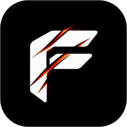
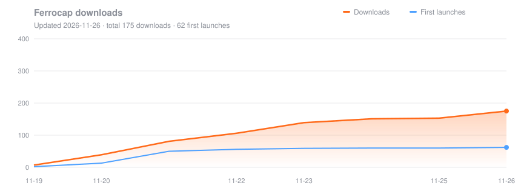

<p align="center"></p>

<h1 align="center">Ferrocap</h1>

<p align="center">Clip it after it happens. A tiny Windows replay buffer that keeps the last seconds of your game in memory and saves them when you press <b>F8</b>.</p>

<p align="center">
  <a href="https://github.com/maykha3v/ferrocap-releases/releases/latest"></a>
  <a href="https://github.com/maykha3v/ferrocap-releases/releases"></a>
  <a href="https://www.ferrocap.xyz"></a>
</p>

## Download

**[Download Ferrocap.exe](https://github.com/maykha3v/ferrocap-releases/releases/latest/download/Ferrocap.exe)** (Windows 10 / 11, about 9 MB)

On first launch Ferrocap downloads its capture engine once (about 88 MB). After that it runs from the tray and updates itself.

Windows SmartScreen may warn about a new app: click **More info → Run anyway**.

## Downloads



Updated once a day by a GitHub Action (`.github/workflows/download-stats.yml`). **Downloads** counts `Ferrocap.exe` downloads across all releases; **first launches** counts capture-engine downloads, which the app does once per install. Raw numbers are in [`stats/downloads.csv`](stats/downloads.csv).

## What it does

* **Replay buffer**, 5 s to 5 min, captured and encoded on your GPU (NVIDIA, AMD or Intel)
* Clips the **game's own window** when a game is running (works in fullscreen), the whole screen otherwise
* **Separate audio tracks**: game, Discord, mic and any app you pick
* Built-in **player and editor**: trim, cut, crop to 9:16, mute tracks, frame blending
* **Ferrocap Snip** replaces Win+Shift+S (optional): region / window / full screen, then draw, highlight, add arrows, text, pixelate and crop
* Lossless screenshots (F9), Discord status, themes, in-app updates

## How it stays out of your game's way

```
Desktop Duplication (whole display)  ─┐
Windows.Graphics.Capture (one window) ─┴─ D3D11 texture ─▶ GPU encoder (NVENC / AMF / Quick Sync)
                                                              │  H.264, never copied to system memory
WASAPI: system · mic · per-app (game, Discord…) ─▶ AAC tracks ─┤
                                                              ▼
                                  MPEG-TS ─▶ RAM ring buffer, cut on 1 s keyframes
                                                              │  F8
                                                              ▼
                     lossless remux ─▶ Videos\Ferrocap\Ferrocap_Clip_2026-11-19_21-04-33.mp4
```

## Source

Rust, all in one file: [`src/main.rs`](src/main.rs). UI is [egui](https://github.com/emilk/egui); capture runs through an FFmpeg sidecar.

### Build

Just run the build script. On a fresh PC it first installs whatever is missing (Rust with the GNU toolchain, WinLibs MinGW and FFmpeg, all through winget), then builds:

```powershell
.\build.ps1
```

Or double-click `build.cmd`.

Output: `dist\Ferrocap.exe` (plus `dist\ffmpeg.exe` for local testing; release builds fetch the engine on first launch).

Dev flags: `--tray` (start hidden), `--page=settings|library`, `--edit=<file.mp4>`, `--snip`.

Settings live in `%APPDATA%\Ferrocap\settings.json`; logs and thumbnails in `%LOCALAPPDATA%\Ferrocap`.
